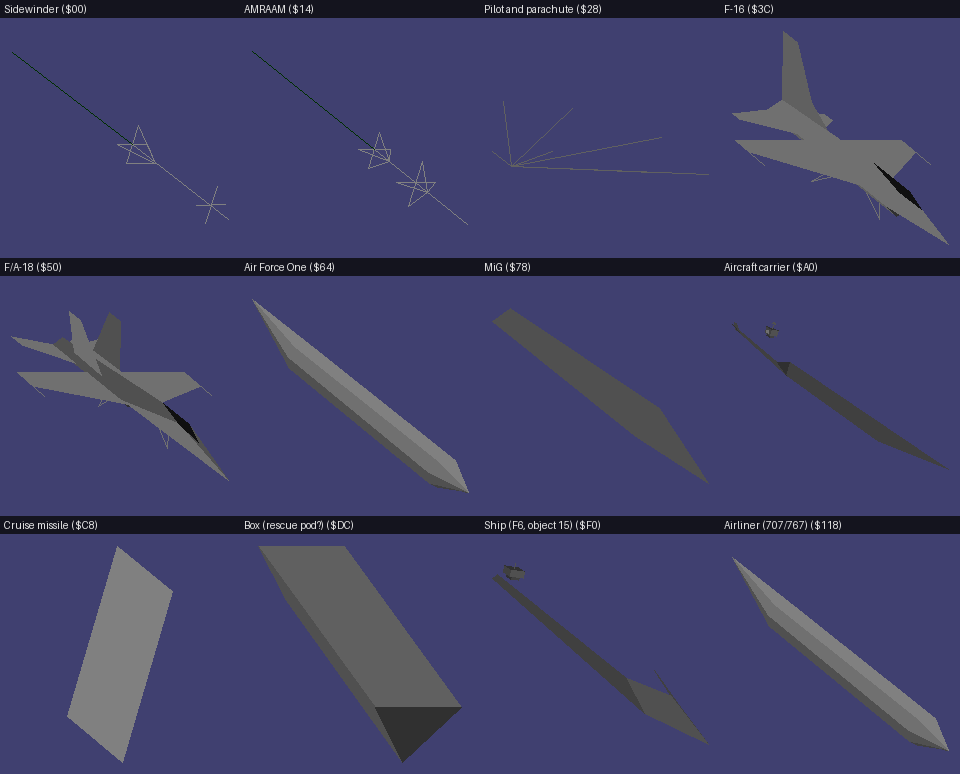
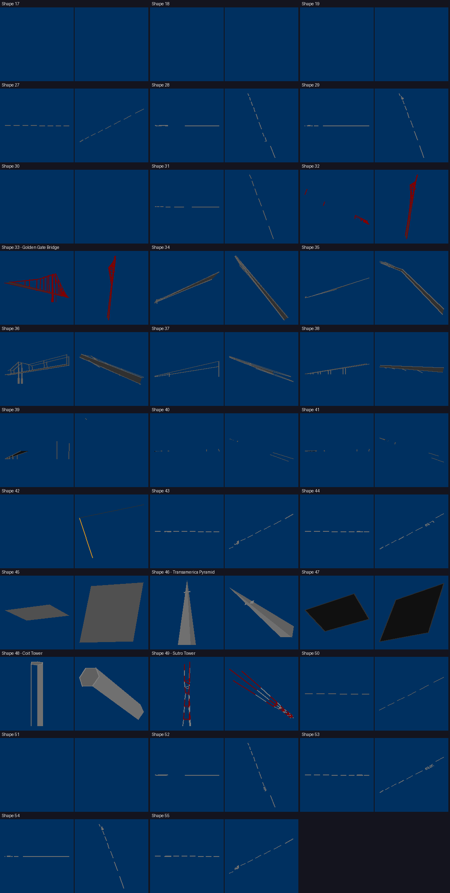

# The 3D models and scenery, drawn

These pictures were made by running the game's own drawing code. `tools/models/` loads the
assembled executable into a 68000 emulator ([unicorn](https://www.unicorn-engine.org/)), sets up
an object and a camera, and calls the game's draw routine for a model (`DrawModel`, hunk 10).
It then captures what the game would have drawn:

* the filled polygons, from `ClipFillPolygon`;
* the lines and the points.

Each primitive is captured in the camera's space and drawn again with Python's PIL, in the
colours of the flight's palette (the instrument panel picture's).

Each picture is scaled to fit its panel, so sizes cannot be compared between pictures.

## How the pictures were made

The pictures were made this way:

* The shadows on the ground are left out (colour 0 and colours `$FCxx`).
* The vertical axis is flipped to stand the shapes upright.
* The view is mirrored left to right, as an image flipped top to bottom is.
* Each picture uses one level of detail, the one picked at the distance the tool sets.

## The models

The models in `ModelTable` (hunk 16), the objects placed by the missions:




Notes on the models:

* The Sidewinder and the AMRAAM are drawn with lines only: a body, the fins and a long line
  behind, probably the smoke trail.
* `$28` (also used as `$104`, the downed pilot of mission F4) is a pilot under his parachute.
* The aircraft have their landing gear down here.
* The two MiG entries share one dark shape.
* One airliner model serves as Air Force One, the 707 and the 767.
* `$F0`, object 15 of mission F6, is a ship like the carrier.
* `$DC` is a plain box, perhaps the rescue pod.
* The cruise missile (`$C8`) comes out as a flat panel at this distance.

## The scenery

The scenery shapes (`ObjectDrawTable` entries 17-117, hunks 42-50 and 54-56) are the San
Francisco Bay area. Each is shown from the side, then from above:




Some can be recognised:

* the Golden Gate Bridge in two halves (32, 33, red);
* the Bay Bridge in sections (34-41);
* the Transamerica Pyramid (46);
* Coit Tower (48);
* Sutro Tower (49, red and white);
* airfield control towers (86, 87).

Most of the rest are runway and taxiway markings, drawn as lines. They include the runways'
numbers (for example 64, 65), which come out mirrored by the flip.

Some shapes are not shown:

* Shapes 17-19, 30, 42, 51, 56, 57, 71, 72 and 117 draw nothing with the tool's settings.
* The shapes drawn by hunk 12's own renderer (`DrawGroundShape`: 20-26, 82-85, 89, 90 and 93-116,
  mostly hunk 70) are not captured yet. Their output does not go through the routines the tool
  hooks.

## Making the pictures

```
pip install unicorn pillow
cd tools/models
python3 gallery.py models          # out/models.png
python3 gallery2.py x              # out/scenery_a.png, out/scenery_b.png
python3 one.py m 0x50 2.5 0.45 out/fa18.png 0x40000 480   # one model: m + ModelTable offset
python3 one.py s 33 0.45 0.0 out/gg.png 0x40000 480        # one scenery shape: s + entry
```

The tool assembles the source with its labels first (`vasmm68k_mot` must be on the path), so
it always draws what the source holds.

* `f18emu.py` is the emulator harness: it loads the hunks, relocates them, keeps the symbols and
  hooks routines.
* `drawmodel.py` sets the scene and runs the draw routine.
* `render.py` draws what was captured.
