# The 3D models and scenery, drawn

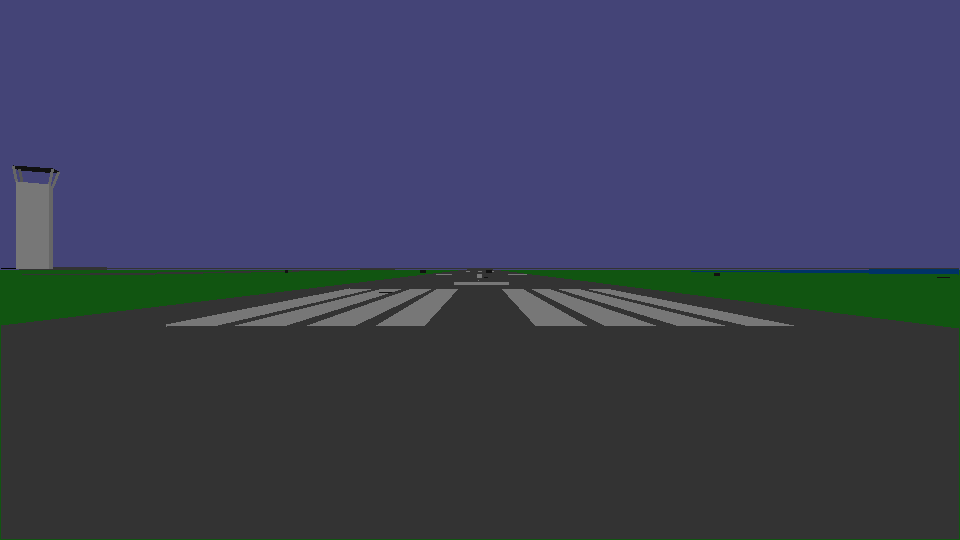

These pictures were made by running the game's own drawing code. `tools/models/` loads the
assembled executable into a 68000 emulator ([unicorn](https://www.unicorn-engine.org/)), sets up
an object and a camera, and calls the game's draw routine for a model (`DrawModel`, hunk 10).
It then captures what the game would have drawn:

* the filled polygons, from `ClipFillPolygon` (both of its entries);
* the lines and the points.

Each primitive is captured in the camera's space and drawn again with Python's PIL, in the
colours of the flight's palette. That is the brightest of the 16 fade levels in hunk 21
(`FlightPalette`), which the game loads for its view.

Each picture is scaled to fit its panel, so sizes cannot be compared between pictures.

## How the pictures were made

The first version of these pictures had faults, since corrected:

* The carrier's deck and other parts were missing. The colour flag `$FCxx` had been taken for a
  shadow, so those faces were left out.
* The polygons drawn through `ClipFillPolygon`'s second entry were not captured. Most of the
  scenery uses that entry.
* Shapes that reached behind the camera were drawn without clipping.
* The pictures were mirrored.
* Faces were missing from some shapes, such as Coit Tower's front. The drawing lists' plane
  tests compare the camera's position against the shape (`ViewOffsetX8`-`00448`), and the tool
  had not set it.
* The colours were taken from the instrument panel picture. Its palette has colours 9 and 11
  the other way round from the game's, which turned the dark green hills orange.
* The emulator kept the first routine it was asked to run and ran it again for later calls.
  It translates code once and keeps it, and the tool rewrote its call in place without
  flushing it.

The pictures were made this way:

* The shadows on the ground (colour 0) are left out. The top bits of a colour word are flags
  (for example `$8000`, drawn from both sides), not shadows.
* The camera is turned round the object, which stays still, and placed far enough away for the
  whole shape to be in front of it. What crosses the near plane is clipped, as in the game.
* Each picture uses the level of detail that gives the most detail.
* The animated models are drawn at their first frame, the timer `+$4C` at 10.

## The models

The models in `ModelTable` (hunk 16), the objects placed by the missions:


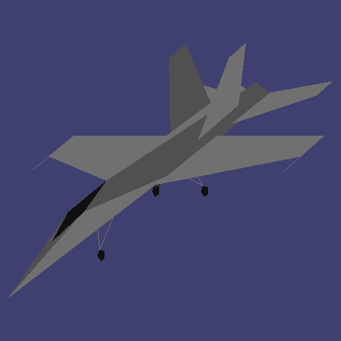

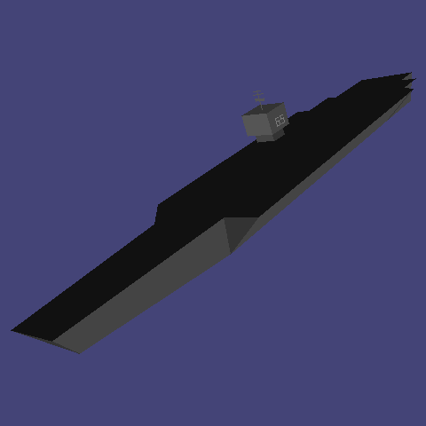

Notes on the models:

* The Sidewinder and the AMRAAM are drawn with lines only: a body, the fins and a long line
  behind, probably the smoke trail.
* `$28` (also used as `$104`, the downed pilot of mission F4) is a pilot under his parachute.
  Its frames (by the timer) show the canopy opening, then lying collapsed on the ground.
* The aircraft have their landing gear down here.
* The two MiG entries share one dark shape.
* The carrier has a dark flight deck, the angled deck stepped along one side, the island and a
  hull under part of the deck.
* One airliner model serves as Air Force One, the 707 and the 767.
* `$F0`, object 15 of mission F6, is the submarine: a long dark hull with its sail. It is the
  shadow sub of the Carrier Sub mission, not a ship as first thought.

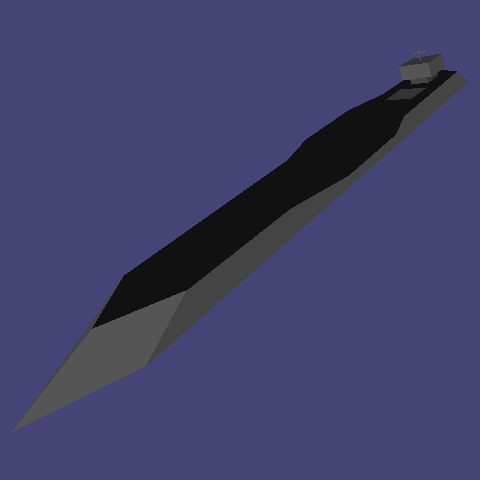
* `$DC` is a box under a parachute: the rescue pod of mission F4. Its frames show the canopy
  opening, then the box on the ground.
* The cruise missile (`$C8`) is drawn with lines, like the Sidewinder and the AMRAAM. Its
  nearest level of detail draws a single large panel, which looks wrong and is not shown.

## The scenery

The scenery shapes (`ObjectDrawTable` entries 17-117, hunks 42-50 and 54-56) are the San
Francisco Bay area. Each is shown from the side, then from above:


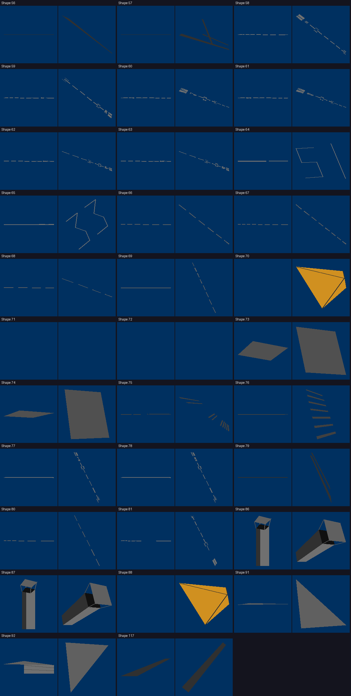

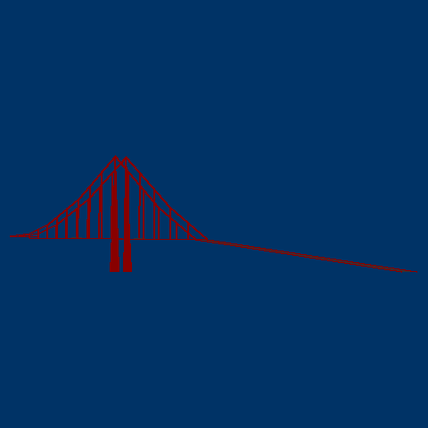

Some can be recognised:

* the Golden Gate Bridge in two halves (32, 33, red);
* the Bay Bridge and the bay's other bridges and causeways, in sections (34-41);
* the Transamerica Pyramid (46);
* Coit Tower (48), a column with its top;
* Sutro Tower (49, red and white);
* airfield control towers (86, 87).

Most of the rest are pieces that only make sense put together:

* runway and taxiway markings, drawn as lines, and runway numbers;
* building blocks;
* the hills and parks, dark green (42).

The scenery maps place them, so the in-game views below show what they make. They include the runways'
numbers (for example 64, 65).

Some shapes are not shown:

* Shapes 17-19 and 51, and a few others, draw nothing with the tool's settings.
* Shapes 22 and 84 (ground shapes) draw nothing either.

### The ground shapes

The shapes drawn by hunk 12's renderer (`DrawGroundShape`: 20-26, 82-85, 89, 90 and 93-116) are
flat: their vertices are only x and z, all at the shape's height, so they are shown from a low
angle and from above. They are the land under the scenery - the city's grey blocks (colour 12)
and the dark green parks and hills (colour 11), drawn on the ground before anything stands on
it - and, as lines (colour 12), the roads and freeways (89-116). Seen on the bay's water:

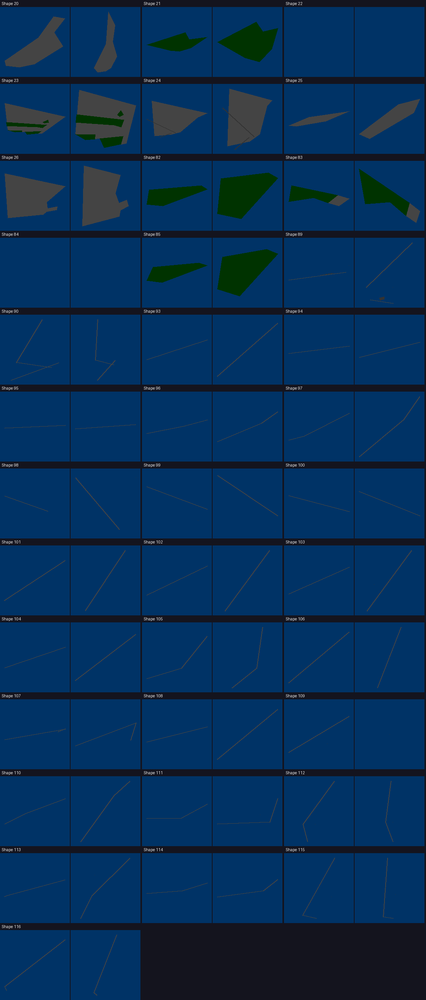

## In the game

`scene.py` goes further and runs the game itself in the emulator. It runs the game's own set-up
routines:

* `ResetGame`;
* `SetupMode` for a free flight;
* the routine that places the aircraft at a starting point.

Then it runs the 3D stages of a frame (`UpdateViewCell`, `SetupCamera`, the scenery lists,
`DrawObjects`...), twice. It captures what reaches the screen: the filled polygons after the
game's clipping and projection, the lines and the points. They are painted in order, in screen
coordinates, so these are the game's own frames.

Colour 9 (orange) is the missiles' exhaust trail; colour 11 (dark green) is the hills and the
pilot's flight suit.

The background is the one part the emulator cannot draw, because the game clears it by blitter
(`ClearSkyGround`): the tool paints it from what the game leaves behind - the ground in colour 4
(land) or 6 (sea, when `SeaView` is set), then the sky polygon that `MakeSkyPolygon` built, in
colour 5. The cockpit is left out.


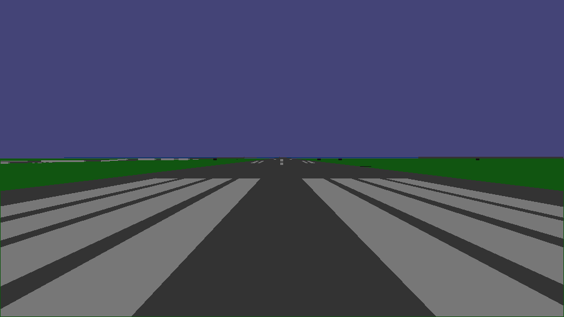
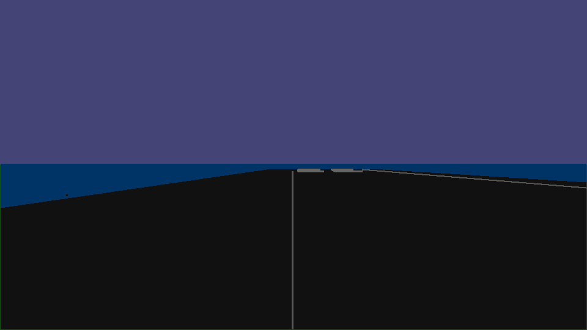
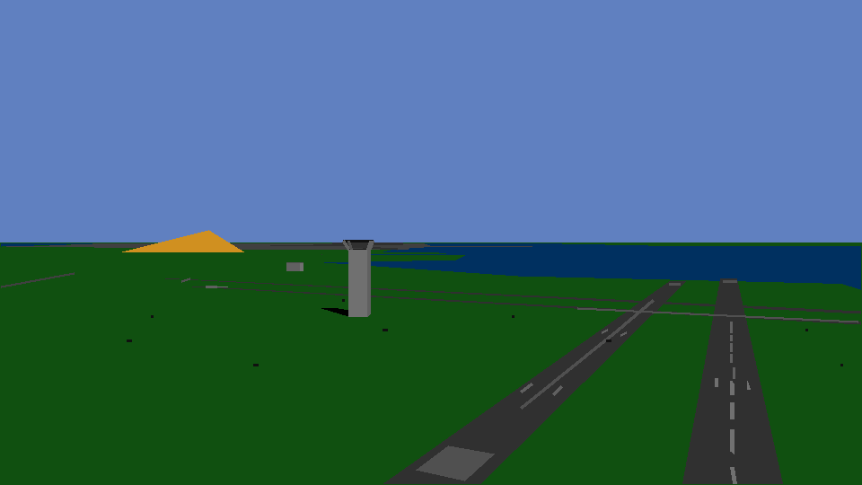
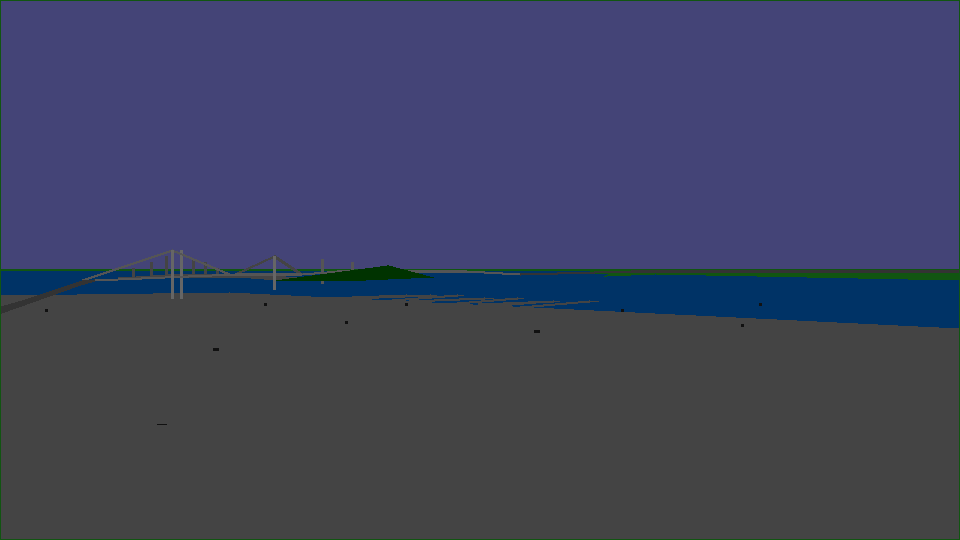
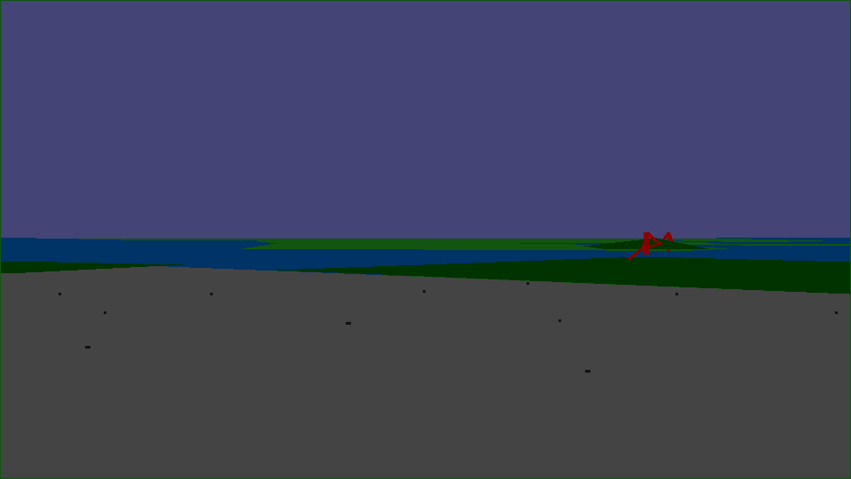
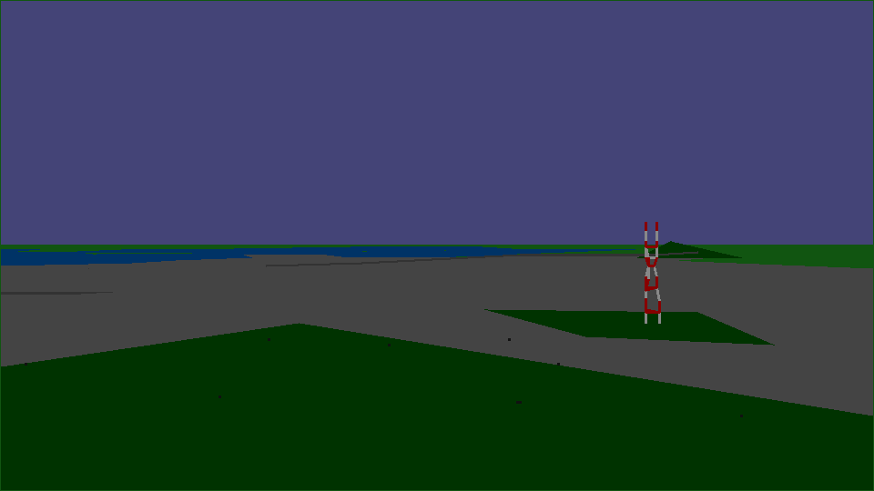

The ground is drawn in the colours of the land, the water (the bay), the city (grey) and the
hills and parks (dark green). The scenery maps' pieces become the airfields with their runways and control
tower, the bridges and the city.

Some places:

* the free flight starts in map cell (65, 66) on an airfield;
* the city around (65-66, 69);
* the Golden Gate Bridge in cell (66, 70).

## Making the pictures

```
pip install unicorn pillow
cd tools/models
python3 gallery.py models          # out/models.png
python3 gallery2.py x              # out/scenery_a.png, out/scenery_b.png, out/scenery_ground.png
python3 opstats.py                 # which shape operations each model and shape uses
python3 hud.py                     # out/hud_fa18.png, out/hud_f16.png: the head-up display
python3 one.py m 0x50 2.5 0.45 out/fa18.png 0 480   # one model: m + ModelTable offset
python3 one.py s 33 0.45 0.0 out/gg.png 0 480        # one scenery shape: s + entry
python3 scene.py 3 "" "" out/carrier.png              # the game's frame at a start point
python3 views.py                                      # the views above, into out/
```

The tool assembles the source with its labels first (`vasmm68k_mot` must be on the path), so
it always draws what the source holds.

* `f18emu.py` is the emulator harness: it loads the hunks, relocates them, keeps the symbols and
  hooks routines.
* `drawmodel.py` sets the scene and runs the draw routine.
* `render.py` draws what was captured.
